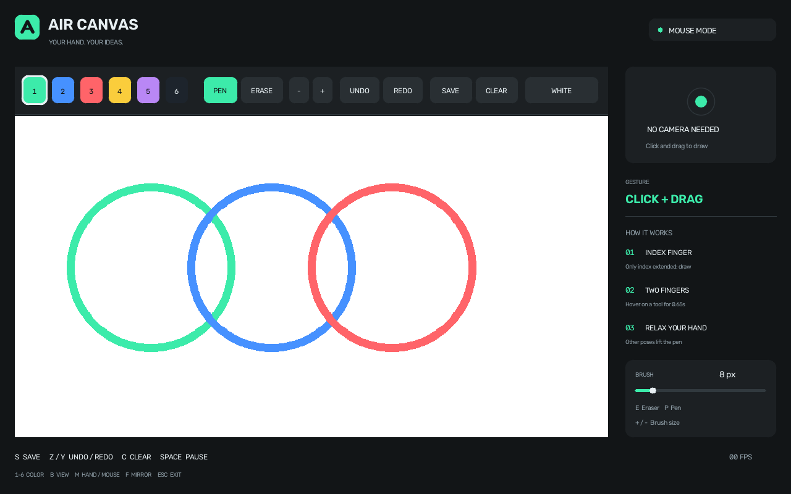

# Air Canvas

Draw with a webcam and your hand, or use a mouse. This Windows-friendly Python
desktop app combines OpenCV, MediaPipe Tasks, and a transparent RGBA canvas.
The included hand model is loaded locally; app startup does not fetch a model.



The illustration above is generated by the built-in demo and does not depict
a live camera or live hand tracking.

## Quick start on Windows

1. Download and extract the [latest project source](https://github.com/parsasafariii2006/air-canvas-python/archive/refs/heads/main.zip).
2. Double-click `START.bat` for webcam mode or `START_MOUSE.bat` for mouse mode.
3. On first launch, setup creates an isolated `.venv` and installs the pinned
   dependencies. Use Python 3.14 x64. The initial setup needs an internet
   connection; it checks the bundled model's SHA-256.
4. Press `S` to save a white-background PNG and a transparent PNG under `drawings/`.

The full Persian user guide and code walkthrough is in [README_FA.md](README_FA.md).

## Hand controls

| Pose | Action |
| --- | --- |
| Only index finger extended | Draw |
| Index and middle fingers extended | Hover over a toolbar button for 0.65 seconds to select it |
| Any other pose, including an open palm | Lift the pen |
| Hand leaves the frame | Stop the stroke immediately |

## Tools

- Six colors, pen, eraser, and brush sizes from 2 to 48 pixels.
- Up to 20 undo steps, redo, and a reversible clear action.
- White or camera background. Camera pixels, toolbar, and cursor never enter exported images.
- Mouse drawing works without opening a camera or loading the tracking model.
- Camera or tracking startup failure falls back to mouse mode.
- `ESC` or `Q` exits; unsaved ink is saved on normal exit.

## Development

```powershell
py -3.14 -m venv .venv
.\.venv\Scripts\python.exe -m pip install -r requirements.txt
.\.venv\Scripts\python.exe -m unittest discover -s tests -v
.\.venv\Scripts\python.exe -m air_canvas --check
```

See [VALIDATION_FA.md](VALIDATION_FA.md) for checked behavior and current test limits.

## License and model

This project and the bundled hand-landmark model are licensed under Apache-2.0.
The model card and official source URL are listed in [models/MODEL_INFO.md](models/MODEL_INFO.md).
The model is distributed with its SHA-256 checksum; `setup.bat --repair-model`
downloads and verifies the official pinned file if it needs repair.

## Sources

- [MediaPipe Hand Landmarker Python guide](https://ai.google.dev/edge/mediapipe/solutions/vision/hand_landmarker/python)
- [Google AI Edge Hand Landmarker model and model card](https://ai.google.dev/edge/mediapipe/solutions/vision/hand_landmarker)
- [OpenCV video capture guide](https://docs.opencv.org/4.x/dd/d43/tutorial_py_video_display.html)
- [Alireza Akhavan's class.vision notebooks](https://github.com/Alireza-Akhavan/class.vision); the drawing, mouse-event,
  and webcam examples were studied as references. This app's implementation
  was written independently.

